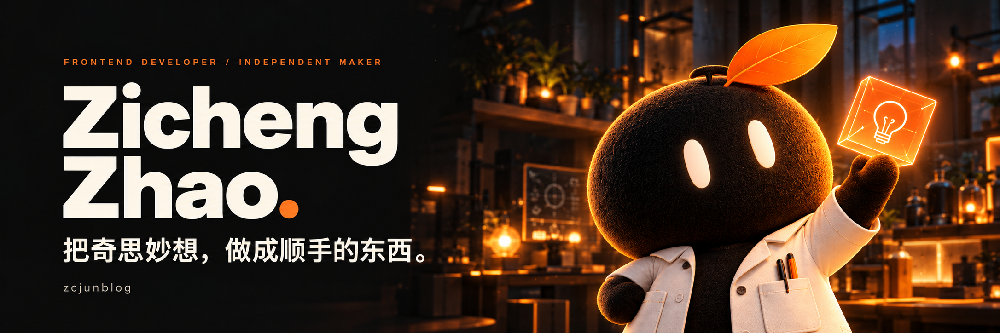
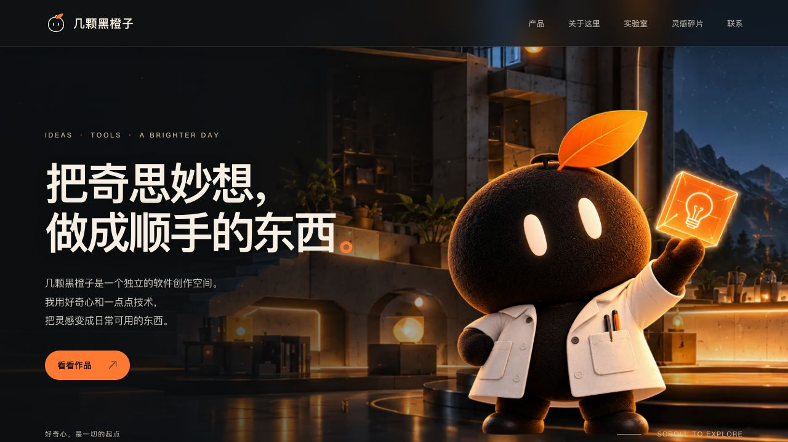
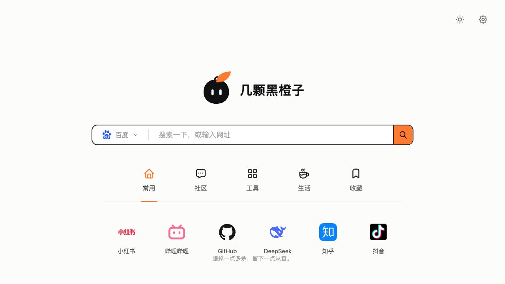

  

你好，我是 **Zicheng Zhao（zcjunblog）**。关注前端开发、Web 应用与实用工具，喜欢把生活里的小想法，慢慢做成可以使用的作品。

[个人创作空间 ↗](https://jkhcz.com/) &nbsp; · &nbsp; [简约导航 ↗](https://nav.gs/) &nbsp; · &nbsp; [全部仓库 ↗](https://github.com/zcjunblog?tab=repositories)

### 01 / 个人作品

<table>
<tr>
<td width="50%" valign="top">

 
<strong><a href="https://jkhcz.com/">几颗黑橙子 ↗</a></strong>

把灵感变成日常可用的东西。

jkhcz.com
</td>
<td width="50%" valign="top">

 
<strong><a href="https://nav.gs/">nav.gs · 简约导航 ↗</a></strong>

搜索与常用网址，简洁开启每一天。

nav.gs
</td>
</tr>
</table>

### 02 / 技术与实践

   &nbsp;&nbsp;
   &nbsp;&nbsp;
   &nbsp;&nbsp;
   &nbsp;&nbsp;
   &nbsp;&nbsp;
  

`TypeScript / JavaScript` &nbsp; `Vue / React` &nbsp; `Node.js / Vite`

从界面交互到项目工具，在实践中积累，也在迭代中打磨。

### 03 / 开源探索

- **[SBTI 赛博人格测定局 ↗](https://github.com/zcjunblog/sbti-test)** — 交互测试、多维画像与海报分享。`Next.js` `React` `TypeScript`
- **[dt-cli ↗](https://github.com/zcjunblog/dt-cli)** — 拉取项目模板，初始化前端项目。`Node.js` `CLI`
- **[Vue 3 项目模板 ↗](https://github.com/zcjunblog/vue3-vite-element-plus-template)** — 前端项目的基础起点。`Vue 3` `TypeScript` `Vite`

---

小小的想法，也值得被认真对待。 Independent maker · Building with curiosity.

