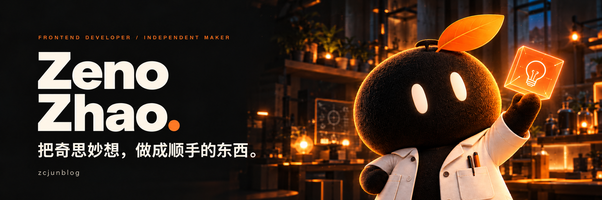
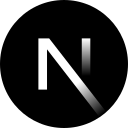
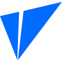

  

你好，我是 **Zeno（Zicheng Zhao）**。专注Web/桌面/App开发、 AI应用与实用工具，喜欢把生活里的小想法，慢慢做成可以使用的作品。

[个人创作空间 ↗](https://jkhcz.com/) &nbsp; · &nbsp; [简约导航 ↗](https://nav.gs/) &nbsp; · &nbsp; [全部仓库 ↗](https://github.com/zcjunblog?tab=repositories)

### 个人技术栈

   &nbsp;
   &nbsp;
   &nbsp;
   &nbsp;
   &nbsp;
   &nbsp;
   &nbsp;
   &nbsp;
   &nbsp;
   &nbsp;
   &nbsp;
   &nbsp;
   &nbsp;
   &nbsp;
   &nbsp;
  

`uni-app` · `Chrome Extensions` · 响应式界面开发

---

小小的想法，也值得被认真对待。 Independent maker · Building with curiosity.

