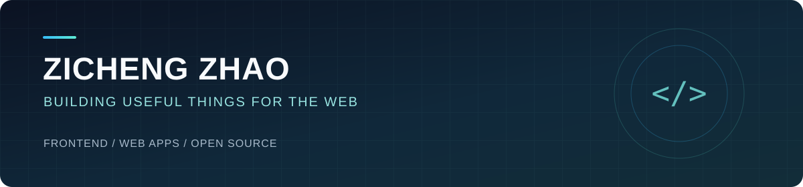

  

<h1 align="center">你好，我是 Zicheng Zhao 👋</h1>

前端开发 · Web 应用 · 开源项目

  <a href="https://x4v.cn/">个人网站</a> &nbsp;·&nbsp;
  <a href="https://github.com/zcjunblog?tab=repositories">全部项目</a> &nbsp;·&nbsp;
  <a href="https://github.com/zcjunblog/google-access-helper-mv3">代表项目</a>

---

### 关于我

我是 **Zicheng Zhao（zcjunblog）**，关注前端开发和实用工具的设计与实现。这里记录了我在浏览器扩展、Web 应用和开发工具方面的项目与探索。

### 精选项目

<table>
<tr>
<td width="50%" valign="top">
<strong><a href="https://github.com/zcjunblog/google-access-helper-mv3">Google Access Helper · MV3</a></strong>  
可安装的 Chrome 扩展，支持代理配置与启停、服务入口、连接诊断和配置导入导出。  
JavaScript · Chrome Extension · Manifest V3  
代理功能需要自备可用的代理服务。
</td>
<td width="50%" valign="top">
<strong><a href="https://github.com/zcjunblog/sbti-test">SBTI 赛博人格测定局</a></strong>  
交互式人格测试站点，包含多维画像、人格图鉴、结果分享和海报生成。  
Next.js · React · TypeScript · Tailwind CSS
</td>
</tr>
<tr>
<td width="50%" valign="top">
<strong><a href="https://github.com/zcjunblog/gpt-redeem">GPT 卡密兑换站</a></strong>  
包含卡密兑换、订单查询和后台管理的 Web 应用，支持响应式布局与深浅主题。  
PHP · MySQL · HTML / CSS / JavaScript  
默认使用模拟接口，真实充值尚未验证。
</td>
<td width="50%" valign="top">
<strong><a href="https://github.com/zcjunblog/dt-cli">dt-cli</a></strong>  
用于拉取项目模板、快速初始化前端项目的命令行工具。  
Node.js · CLI · 项目模板
</td>
</tr>
</table>

### 技术与探索

`JavaScript` &nbsp; `TypeScript` &nbsp; `HTML / CSS` &nbsp; `Vue` &nbsp; `React` &nbsp; `Node.js` &nbsp; `Chrome Extensions` &nbsp; `PHP` &nbsp; `MySQL`

从页面交互、项目模板到浏览器工具，希望把想法变成可以使用、可以维护的作品。

---

感谢来访 · 欢迎通过各项目的 Issues 交流

